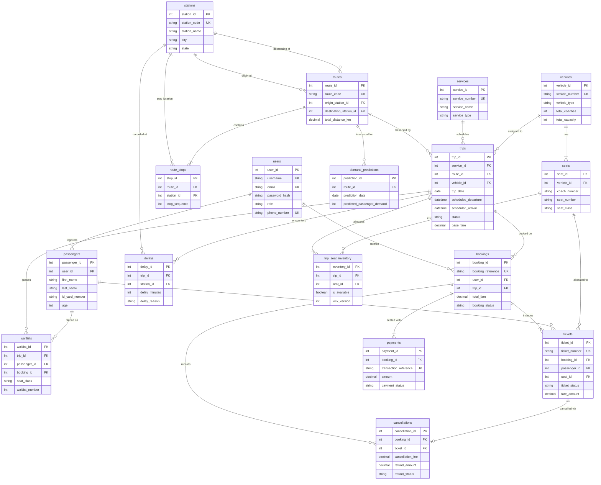

# TransitMatrix - Entity-Relationship (ER) & Enhanced ER (EER) Modeling

## 1. System Overview
TransitMatrix is a relational database management system designed to support railway and public transit operations. The system models train timetables, multi-station route hierarchies, physical train coach compositions, granular seat inventory, transactional passenger ticket bookings, payment processing, ticket cancellations with waitlist escalation, operational delays, auditing, and passenger demand forecasting.

This document describes the conceptual and logical data model using standard Entity-Relationship (ER) and Enhanced Entity-Relationship (EER) modeling concepts as taught in university Database Management Systems (DBMS) coursework.

---

## 2. Entity Sets and Attributes

### 2.1 Strong Entity Sets
1. **User (`users`)**
   - Represents registered accounts (passengers, booking counter operators, and system administrators).
   - Attributes:
     - `user_id` (Primary Key, Integer, Surrogate)
     - `username` (Candidate Key, Varchar)
     - `email` (Candidate Key, Varchar)
     - `password_hash` (Varchar, Stored BCrypt/Argon2 digest)
     - `role` (Enum: 'ADMIN', 'STAFF', 'PASSENGER')
     - `first_name`, `last_name` (Varchar)
     - `phone_number` (Candidate Key, Varchar)
     - `is_active` (Boolean)
     - `created_at`, `updated_at` (Timestamps)

2. **Passenger (`passengers`)**
   - Represents physical individuals traveling on transit services. A user account may book tickets for multiple distinct passengers (e.g., family members).
   - Attributes:
     - `passenger_id` (Primary Key, Integer)
     - `user_id` (Foreign Key referencing `users(user_id)`, Nullable for guest travelers)
     - `first_name`, `last_name` (Varchar)
     - `gender` (Enum: 'MALE', 'FEMALE', 'OTHER')
     - `age` (Integer, Check: 1 <= age <= 120)
     - `id_card_type` (Enum: 'AADHAAR', 'PASSPORT', 'PAN', 'VOTER_ID', 'DRIVING_LICENSE')
     - `id_card_number` (Varchar)
     - `email`, `phone_number` (Varchar, Optional)

3. **Station (`stations`)**
   - Represents physical railway stations and transit hubs across the network.
   - Attributes:
     - `station_id` (Primary Key, Integer)
     - `station_code` (Candidate Key, Varchar, e.g., NDLS, BCT, HWH)
     - `station_name` (Varchar)
     - `city` (Varchar)
     - `state` (Varchar)
     - `zone` (Varchar, e.g., Northern Railway, Western Railway)
     - `total_platforms` (Integer, Check: total_platforms >= 1)
     - `latitude`, `longitude` (Decimal coordinates)
     - `is_active` (Boolean)

4. **Service (`services`)**
   - Represents a cataloged transit train service (e.g., Mumbai Rajdhani Express, Vande Bharat Express).
   - Attributes:
     - `service_id` (Primary Key, Integer)
     - `service_number` (Candidate Key, Varchar, e.g., '12951')
     - `service_name` (Varchar)
     - `service_type` (Enum: 'RAJDHANI', 'SHATABDI', 'VANDE_BHARAT', 'SUPERFAST', 'EXPRESS', 'INTERCITY', 'SUBURBAN')
     - `operating_days` (Varchar set, e.g., 'MON,TUE,WED,THU,FRI,SAT,SUN')
     - `is_active` (Boolean)

5. **Vehicle / Train Rake (`vehicles`)**
   - Represents the physical rolling stock rake assigned to run a trip.
   - Attributes:
     - `vehicle_id` (Primary Key, Integer)
     - `vehicle_number` (Candidate Key, Varchar, e.g., 'TRAIN-WAP7-12951')
     - `vehicle_type` (Enum: 'LOCOMOTIVE_TRAIN', 'ELECTRIC_MULTIPLE_UNIT', 'METRO_RAIL', 'DIESEL_MULTIPLE_UNIT')
     - `model_name` (Varchar)
     - `manufacture_year` (Integer)
     - `total_coaches` (Integer)
     - `total_capacity` (Integer)
     - `maintenance_status` (Enum: 'OPERATIONAL', 'UNDER_MAINTENANCE', 'DECOMMISSIONED')

6. **Route (`routes`)**
   - Represents an ordered path between an origin and a destination station.
   - Attributes:
     - `route_id` (Primary Key, Integer)
     - `route_code` (Candidate Key, Varchar, e.g., 'RT-NDLS-BCT')
     - `route_name` (Varchar)
     - `origin_station_id` (Foreign Key referencing `stations(station_id)`)
     - `destination_station_id` (Foreign Key referencing `stations(station_id)`)
     - `total_distance_km` (Decimal)
     - `duration_est_minutes` (Integer)

7. **Trip (`trips`)**
   - Represents an operational scheduled instance of a service traversing a specific route on a concrete date with an assigned vehicle.
   - Attributes:
     - `trip_id` (Primary Key, Integer)
     - `service_id` (Foreign Key referencing `services(service_id)`)
     - `route_id` (Foreign Key referencing `routes(route_id)`)
     - `vehicle_id` (Foreign Key referencing `vehicles(vehicle_id)`)
     - `trip_date` (Date)
     - `scheduled_departure` (DateTime)
     - `scheduled_arrival` (DateTime)
     - `actual_departure` (DateTime, Nullable)
     - `actual_arrival` (DateTime, Nullable)
     - `status` (Enum: 'SCHEDULED', 'BOARDING', 'ON_TIME', 'DELAYED', 'CANCELLED', 'COMPLETED')
     - `base_fare` (Decimal)

8. **Booking (`bookings`)**
   - Represents a passenger reservation transaction.
   - Attributes:
     - `booking_id` (Primary Key, Integer)
     - `booking_reference` (Candidate Key, PNR 10-character code)
     - `user_id` (Foreign Key referencing `users(user_id)`)
     - `trip_id` (Foreign Key referencing `trips(trip_id)`)
     - `booking_date` (Timestamp)
     - `total_passengers` (Integer)
     - `total_fare` (Decimal)
     - `booking_status` (Enum: 'PENDING', 'CONFIRMED', 'CANCELLED', 'PARTIALLY_CANCELLED', 'WAITLISTED')

---

### 2.2 Weak and Associative Entity Sets

1. **Route Stop (`route_stops`)**
   - Represents intermediate halts of a route in strict sequential order.
   - Identifying Relationship: Part of `routes`.
   - Primary Key: `stop_id` (Surrogate) with Composite Candidate Key `(route_id, stop_sequence)`.
   - Attributes: `distance_from_origin_km`, `departure_offset_minutes`, `arrival_offset_minutes`, `platform_number`.

2. **Seat (`seats`)**
   - Represents a physical seat inside a coach of a vehicle.
   - Identifying Relationship: Part of `vehicles`.
   - Primary Key: `seat_id` (Surrogate) with Composite Candidate Key `(vehicle_id, coach_number, seat_number)`.
   - Attributes: `seat_class` ('1A', '2A', '3A', 'SL', 'CC', 'EC', 'GEN'), `seat_type` ('LOWER', 'MIDDLE', 'UPPER', 'SIDE_LOWER', 'SIDE_UPPER', 'WINDOW', 'AISLE'), `fare_multiplier`.

3. **Trip Seat Inventory (`trip_seat_inventory`)**
   - Associates a concrete `trip` with a physical `seat` for transactional state tracking.
   - Primary Key: `inventory_id` with Composite Candidate Key `(trip_id, seat_id)`.
   - Attributes: `is_available` (Boolean), `reserved_at` (DateTime), `held_until` (DateTime), `lock_version` (Integer).

4. **Ticket (`tickets`)**
   - Represents a single traveler permit within a booking.
   - Primary Key: `ticket_id` with Candidate Key `ticket_number`.
   - Foreign Keys: `booking_id`, `passenger_id`, `seat_id` (Nullable if waitlisted), `origin_station_id`, `destination_station_id`.
   - Attributes: `fare_amount`, `ticket_status` ('CONFIRMED', 'CANCELLED', 'WAITLISTED', 'RAC').

5. **Payment (`payments`)**
   - Represents financial remittance for a booking.
   - Primary Key: `payment_id` with Candidate Key `transaction_reference`.
   - Foreign Key: `booking_id`.
   - Attributes: `payment_method`, `amount`, `payment_status`, `paid_at`.

6. **Cancellation (`cancellations`)**
   - Captures the refund calculation and cancellation record for a specific ticket.
   - Primary Key: `cancellation_id`.
   - Foreign Keys: `booking_id`, `ticket_id`.
   - Attributes: `cancellation_reason`, `cancellation_fee`, `refund_amount`, `refund_status`, `cancelled_at`.

7. **Waitlist (`waitlists`)**
   - Represents queued booking requests for fully booked trips.
   - Primary Key: `waitlist_id`.
   - Composite Candidate Key: `(trip_id, seat_class, waitlist_number)`.
   - Foreign Keys: `trip_id`, `passenger_id`, `booking_id`.
   - Attributes: `seat_class`, `waitlist_number`, `status` ('WAITING', 'CONFIRMED', 'CANCELLED', 'EXPIRED').

8. **Delay Record (`delays`)**
   - Operational event capturing train delays at specific stations.
   - Primary Key: `delay_id`.
   - Foreign Keys: `trip_id`, `station_id`.
   - Attributes: `delay_minutes`, `delay_reason`, `remarks`, `recorded_at`.

9. **Audit Log (`audit_logs`)**
   - Security and compliance audit trail tracking DML mutations.
   - Primary Key: `log_id`.
   - Attributes: `table_name`, `record_id`, `action`, `old_values`, `new_values`, `changed_by`, `changed_at`.

10. **Demand Prediction (`demand_predictions`)**
    - Machine learning forecast results generated by regression models.
    - Primary Key: `prediction_id`.
    - Foreign Key: `route_id`.
    - Attributes: `prediction_date`, `predicted_passenger_demand`, `confidence_lower_bound`, `confidence_upper_bound`, `model_name`, `model_version`, `generated_at`.

---

## 3. Relationship Cardinalities and Participation

| Relationship | Entity 1 | Entity 2 | Cardinality | Participation (E1, E2) | Foreign Key Placement |
|---|---|---|---|---|---|
| User Registers Passenger Profiles | User | Passenger | 1 : N | Partial, Partial | `passengers.user_id` |
| Route Origin Station | Station | Route | 1 : N | Partial, Total | `routes.origin_station_id` |
| Route Destination Station | Station | Route | 1 : N | Partial, Total | `routes.destination_station_id` |
| Route Has Stops | Route | Route Stop | 1 : N | Total, Total | `route_stops.route_id` |
| Stop Located At Station | Station | Route Stop | 1 : N | Partial, Total | `route_stops.station_id` |
| Vehicle Contains Seats | Vehicle | Seat | 1 : N | Total, Total | `seats.vehicle_id` |
| Service Operates Route Trips | Service | Trip | 1 : N | Partial, Total | `trips.service_id` |
| Route Assigned To Trip | Route | Trip | 1 : N | Partial, Total | `trips.route_id` |
| Vehicle Assigned To Trip | Vehicle | Trip | 1 : N | Partial, Total | `trips.vehicle_id` |
| Trip Has Seat Inventory | Trip | Seat Inventory | 1 : N | Total, Total | `trip_seat_inventory.trip_id` |
| Seat Mapped in Inventory | Seat | Seat Inventory | 1 : N | Partial, Total | `trip_seat_inventory.seat_id` |
| User Places Bookings | User | Booking | 1 : N | Partial, Total | `bookings.user_id` |
| Trip Receives Bookings | Trip | Booking | 1 : N | Partial, Total | `bookings.trip_id` |
| Booking Contains Tickets | Booking | Ticket | 1 : N | Total, Total | `tickets.booking_id` |
| Ticket Assigned To Passenger | Passenger | Ticket | 1 : N | Partial, Total | `tickets.passenger_id` |
| Ticket Reserves Seat | Seat | Ticket | 1 : N | Partial, Partial | `tickets.seat_id` |
| Booking Paid By Payment | Booking | Payment | 1 : N | Total, Total | `payments.booking_id` |
| Ticket Cancelled By Cancellation | Ticket | Cancellation | 1 : 1 | Partial, Total | `cancellations.ticket_id` |
| Trip Manages Waitlist | Trip | Waitlist | 1 : N | Partial, Total | `waitlists.trip_id` |
| Trip Experiences Delays | Trip | Delay Record | 1 : N | Partial, Total | `delays.trip_id` |
| Station Associated With Delay | Station | Delay Record | 1 : N | Partial, Total | `delays.station_id` |
| Route Has Demand Predictions | Route | Demand Prediction | 1 : N | Partial, Total | `demand_predictions.route_id` |

---

## 4. Mermaid ER Diagram

